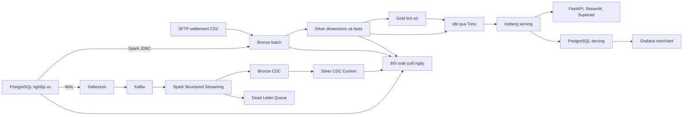

# Banking Data Platform

[English](README.md) · [Sơ đồ kiến trúc](ARCHITECTURE.md) · [Hướng dẫn demo](DEMO_GUIDE.md) · [Vận hành](RUNBOOK.md)

Nền tảng lakehouse mô phỏng dữ liệu của một ngân hàng bán lẻ Việt Nam. Dự án dùng dữ liệu giả lập để triển khai xử lý theo ngày chốt sổ, thu thập thay đổi gần thời gian thực, công bố dữ liệu phân tích và đối soát giữa các đường xử lý.

- **Phân tích khách hàng và rủi ro.** Tổng hợp Customer 360, AUM, hành vi giao dịch, phân khúc RFM, nguy cơ rời bỏ, chỉ báo gian lận và chất lượng danh mục vay.
- **Phân tích merchant QR/POS.** Theo dõi doanh thu, số giao dịch, hoàn tiền, xếp hạng và giờ cao điểm. Đối soát dữ liệu giữa nguồn, batch, CDC và file settlement.
- **Kiểm chứng dữ liệu.** Kiểm tra ngày chốt, khóa và grain của bảng, schema, chất lượng dữ liệu, quyền truy cập và khả năng khôi phục sau khi chạy lại.

## Kiến trúc



Airflow điều phối pipeline và chờ cờ hoàn thành theo ngày nghiệp vụ. Spark xử lý dữ liệu trên Iceberg, Iceberg REST Catalog quản lý bảng và MinIO lưu file. Trino truy vấn cùng các bảng Iceberg qua catalog `iceberg`, còn Spark dùng tên `lakehouse`. Docker Compose có các profile cho batch, streaming, ứng dụng, giám sát và quản trị. [Kiến trúc chi tiết](docs/02-architecture/architecture.md) · [Docker Compose](docker/docker-compose.yml)

## Dữ liệu nghiệp vụ

| Phân hệ | Dữ liệu |
| --- | --- |
| Core Banking | Khách hàng, chi nhánh, sản phẩm, tài khoản, tiền gửi, khoản vay, kỳ trả nợ và giao dịch tài khoản |
| Card và CRM | Thẻ, giao dịch thẻ và lịch sử tương tác khách hàng |
| Digital Banking | Giao dịch online, thiết bị, vị trí, yêu cầu hỗ trợ, merchant, cửa hàng và mã ngành hàng MCC |
| Settlement | File CSV từ SFTP phục vụ đối soát tiền và số lượt giao dịch theo merchant, ngày quyết toán và tiền tệ |

Generator hỗ trợ `--as-of` để neo trục thời gian và `--scale` để thay đổi quy mô. Các bảng giao dịch lớn được sinh và ghi theo khối. [Generator](data_generator/generate_all.py) · [Cấu hình dữ liệu mẫu](data_generator/config/seed_config.yaml) · [Từ điển dữ liệu](docs/03-data/DATA_DICTIONARY.md)

## Đường batch

1. **Bronze** đọc PostgreSQL qua JDBC và đọc file settlement qua SFTP. YAML định nghĩa nguồn, SQL, bảng đích và cách nạp. Các bảng tham chiếu thường được chụp theo ngày. Ba bảng giao dịch tài khoản, thẻ và online nạp tăng dần theo ngày nghiệp vụ của giao dịch.
2. **Silver** chuẩn hóa dữ liệu thành dimension và fact. SCD1 cập nhật thuộc tính theo khóa nghiệp vụ. SCD2 mở phiên bản mới khi thuộc tính được theo dõi thay đổi, đồng thời đóng phiên bản trước bằng `effective_to`. Các fact có grain rõ ràng, chẳng hạn một giao dịch online hoặc một kỳ trả nợ.
3. **Gold** xây mart lịch sử theo `cob_dt`. Job kiểm tra snapshot nguồn được khai báo, kết quả rỗng ở model có yêu cầu và tương thích schema trước khi ghi. Customer 360 tổng hợp các bảng con về grain khách hàng trước khi join để tránh nhân số dòng hoặc số tiền.
4. **Serving** lấy lát cắt theo ngày được chỉ định. DAG hằng ngày chạy dbt qua Trino và ghi cờ hoàn thành sau khi build thành công. Một số model merchant đọc trực tiếp từ Silver. Job riêng có thể sao chép các bảng serving sang PostgreSQL để phục vụ truy vấn theo khóa.

### Ngày nghiệp vụ

Timestamp được lưu theo UTC. Ngày nghiệp vụ tính theo `Asia/Ho_Chi_Minh`. Ví dụ, giao dịch lúc 01:30 ngày 2 tại Việt Nam được lưu là 18:30 UTC ngày 1 và thuộc partition giao dịch ngày 2. Đối với bảng snapshot, `cob_dt` biểu thị ngày chốt dữ liệu. Đối với ba bảng giao dịch incremental, `cob_dt` là ngày nghiệp vụ của từng giao dịch. Lần nạp đầu dùng `backfill_from` để mở rộng khoảng lịch sử.

Airflow lấy ngày ICT từ `data_interval_start`. Lượt chạy thủ công có thể truyền `cob_dt` trong cấu hình trigger. Dùng cùng ngày cho seed, batch và dbt giúp các chỉ số theo cửa sổ 30 hoặc 90 ngày đọc đúng dữ liệu. [Quy ước ngày trong Airflow](airflow/plugins/cob_dt.py) · [ADR về incremental](docs/02-architecture/adr/0018-incremental-transaction-facts.md)

### Mart và bảng phục vụ

| Nhóm | Bảng hoặc mô hình tiêu biểu | Câu hỏi nghiệp vụ |
| --- | --- | --- |
| Khách hàng | `mart_customer_360_current`, các bảng tổng hợp số dư, giao dịch, thẻ, vay và sản phẩm | Khách đang dùng sản phẩm gì, có bao nhiêu tài sản và hoạt động qua kênh nào? |
| Marketing | `rfm_segment_current`, `churn_prediction_current`, `campaign_target_current` | Khách thuộc phân khúc nào và nên nhận chiến dịch nào? |
| Rủi ro | `fraud_risk_txn_current`, `aml_monitoring_current`, các model delinquency, roll rate và vintage | Giao dịch nào cần xem xét, danh mục vay quá hạn đang biến động ra sao? |
| Merchant | `merchant_360_current`, `merchant_daily_summary_current`, `merchant_ranking_current` | Merchant có doanh thu bao nhiêu, đứng ở vị trí nào trong nhóm ngành hàng, giao dịch tập trung vào lúc nào? |

Mart churn dùng quy tắc theo thời gian kể từ giao dịch cuối. Các script trong `ml/` cung cấp luồng thử nghiệm riêng cho churn, credit scoring và drift. [Mô hình dbt](dbt/README.md) · [Tài liệu đầu ra](docs/03-data/data-output-documentation.md) · [FastAPI](api/README.md)

## Đường CDC và đối soát

Debezium đọc WAL của PostgreSQL, đưa sự kiện vào Kafka và để Spark xử lý theo micro-batch. Bronze CDC giữ lịch sử dạng append-only. Bản ghi lỗi được đưa sang DLQ. Checkpoint giữ tiến độ đọc Kafka. DAG consolidation chạy mỗi 10 phút, cập nhật `dim_customer_current`, `dim_account_current` và `fact_online_transaction_current`.

Engine consolidation lưu snapshot Iceberg cuối đã xử lý và chỉ tiến watermark sau khi ghi đích thành công. Trong mỗi lượt, job chọn sự kiện mới nhất theo khóa trước khi `MERGE` vào bảng current. Event contract có topic registry, JSON Schema, kiểm tra tương thích và ledger cho luồng governed event. [Thiết kế CDC](docs/02-architecture/cdc-pipeline.md) · [Engine consolidation](code_etl/cdc/consolidation/cdc_consolidation.py) · [Event contract](docs/03-data/event-contract-rollout.md)

| Đối soát | Các phía được so sánh | Chỉ số |
| --- | --- | --- |
| EOD merchant QR/POS | PostgreSQL nguồn, Silver batch, Silver CDC Current | Số giao dịch thành công, tổng tiền và số hoàn tiền theo merchant, kênh và tiền tệ |
| Settlement | Giao dịch thành công và dữ liệu settlement đã quyết toán | Tổng tiền, số giao dịch, khóa trùng hoặc thiếu theo merchant, ngày quyết toán và tiền tệ |

Đối soát EOD chạy trong DAG riêng lúc 22:00. DAG dbt chờ Gold, còn DAG đồng bộ PostgreSQL chờ dbt. Bằng chứng đối soát merchant dùng fixture Docker cô lập. Fixture settlement seed dữ liệu quyết toán trực tiếp vào PostgreSQL. [Bằng chứng EOD](docs/evidence/td22-merchant-eod-three-way.md) · [Bằng chứng settlement](docs/evidence/td22-merchant-settlement-reconciliation.md)

## Chạy thử trên máy local

Cần Docker và Compose v2, Git, GNU Make, Bash và Python 3.10 trở lên. Dùng Git Bash hoặc WSL trên Windows. Bắt đầu với profile batch khi cần Spark, Airflow, Trino và dbt.

```bash
git clone https://github.com/minzi03/banking_data_platform.git
cd banking_data_platform
cp docker/.env.example docker/.env
# Điền các giá trị CHANGE_ME trong docker/.env trước khi khởi động.
make up-batch
make status
```

Nếu môi trường thiếu lệnh `python3`, chạy `make PYTHON="py -3" up-batch` khi đã cài Python Launcher. Phần cấu hình quyền Docker socket cho Airflow có trong [Runbook](RUNBOOK.md).

Khi PostgreSQL, Airflow và các job khởi tạo đã sẵn sàng, tạo dữ liệu mẫu rồi nạp Bronze, Silver và Gold theo thứ tự. Dừng nếu một bước lỗi. Sau đó, dùng dbt để tạo bảng serving cho cùng ngày. [Makefile](Makefile) · [Cấu hình dbt](dbt/profiles.yml)

```bash
COB=2026-09-29
make seed AS_OF="$COB"
make bronze-bootstrap COB_DT="$COB"
make silver-bootstrap COB_DT="$COB"
make gold-bootstrap COB_DT="$COB"
make validate-pipeline COB_DT="$COB"
docker exec banking-dbt dbt deps
docker exec banking-dbt dbt build --target docker --select serving --vars "{\"cob_dt\": \"$COB\"}"
make trino
```

Trong Trino, kiểm tra grain Customer 360 và ngày dữ liệu đang được phục vụ.

```sql
SELECT
    cob_dt,
    count(*) AS row_count,
    count(DISTINCT customer_id) AS customer_count
FROM iceberg.serving.mart_customer_360_current
GROUP BY cob_dt
ORDER BY cob_dt DESC;
```

Sau khi nạp thành công, truy vấn kỳ vọng một ngày dữ liệu và hai phép đếm bằng nhau. Để demo chuỗi DAG, publish qua dbt, kiểm tra chuyển phiên bản SCD2 hoặc chạy CDC, làm theo [Demo Guide](DEMO_GUIDE.md). Dùng `make up` khi muốn dựng đầy đủ các profile.

## Quản trị, kiểm thử và vận hành

- **Chất lượng dữ liệu.** Data contract mô tả schema, chủ sở hữu, SLA và quy tắc chất lượng. Các job kiểm tra null, khóa trùng, khoảng giá trị, khóa tham chiếu, schema drift và freshness. Bản ghi vi phạm có thể được đưa vào quarantine. [Data contracts](docs/03-data/DATA_CONTRACTS.md) · [Data Quality](docs/05-quality/DATA_QUALITY.md)
- **Truy cập và theo dõi.** Trino có xác thực qua HTTPS, chính sách sinh từ RBAC và che cột PII. OpenMetadata phục vụ catalog và lineage. Prometheus, Grafana và freshness exporter theo dõi trạng thái hệ thống và độ mới của dữ liệu. [Ma trận RBAC](docs/06-security-compliance/RBAC_MATRIX.md) · [Thiết kế giám sát](docs/02-architecture/observability-design.md)
- **Kiểm thử.** CI kiểm tra mã nguồn, YAML, hợp đồng và bất biến dữ liệu. Gate tích hợp dựng topology Docker với Trino/Iceberg để kiểm trên đầu ra pipeline. Evidence manifest ghi ngày đo, nguồn đo và phạm vi xác minh. [CI](.github/workflows/ci.yml) · [Chiến lược test](docs/05-quality/TESTING_STRATEGY.md) · [Evidence manifest](docs/evidence/metrics-manifest.yaml)
- **Xử lý sự cố.** Cờ ETL phục vụ điều phối. `pipeline_run_log` ghi vòng đời thực thi. `reconciliation_log` ghi kết quả đối soát nghiệp vụ. Runbook có lệnh đọc báo cáo, kiểm tra freshness, backfill, replay CDC và rollback snapshot Iceberg. [Runbook](RUNBOOK.md) · [Incident Runbook](docs/04-operations/INCIDENT_RUNBOOK.md)

```bash
python -m pytest -m "not integration"
python scripts/verify_readme_metrics.py
```

Lệnh kiểm chứng README đối chiếu các chỉ số trong bản tiếng Anh với manifest. Bộ integration có hướng dẫn dựng hạ tầng trong tài liệu kiểm thử.

## Phạm vi hiện tại

- Dữ liệu là dữ liệu mô phỏng và stack hướng đến phát triển local. Nhịp micro-batch, cron consolidation và lịch đồng bộ PostgreSQL quyết định độ trễ từng tầng.
- CDC hỗ trợ replay theo checkpoint và watermark. Bảng current-state xóa dòng khi nhận delete, nên sự kiện cũ đến muộn có thể tạo lại khóa đã xóa. Phạm vi bảo đảm replay được mô tả trong [ADR về thứ tự CDC](docs/02-architecture/adr/0010-cdc-event-ordering.md).
- Giao dịch có `merchant_id`. KPI theo cửa hàng cần thêm liên kết giao dịch với `store_id`. Bằng chứng settlement hiện tập trung vào số lượt và tổng tiền ở grain tổng hợp.
- Số liệu công bố gắn với lần đo cụ thể. Chẳng hạn, con số **2,3 triệu giao dịch tài chính phân biệt** trong manifest được tính qua ba miền tài khoản, thẻ và online theo định nghĩa của lần đo. [Manifest](docs/evidence/metrics-manifest.yaml)

## Cấu trúc repo

| Đường dẫn | Vai trò |
| --- | --- |
| [`data_generator/`](data_generator) | Sinh và nạp dữ liệu mô phỏng |
| [`code_etl/`](code_etl) | Job Bronze, Silver, Gold, CDC, serving và vận hành dữ liệu |
| [`airflow/`](airflow) | DAG, sensor, cờ ETL và quy ước ngày chốt |
| [`dbt/`](dbt) | Model serving, test, exposure và định nghĩa metric |
| [`governance/`](governance), [`schemas/`](schemas) | Hợp đồng dữ liệu, RBAC, lineage, schema drift và event contract |
| [`docker/`](docker) | Compose, Dockerfile, DDL, cấu hình Spark, Trino và monitoring |
| [`api/`](api), [`streamlit/`](streamlit), [`ml/`](ml) | API, ứng dụng phân tích và thử nghiệm mô hình |
| [`scripts/`](scripts), [`tests/`](tests) | Công cụ vận hành, verifier và kiểm thử |
| [`docs/`](docs/INDEX.md) | Kiến trúc, từ điển dữ liệu, quy trình vận hành và bằng chứng chạy |

Đóng góp theo [CONTRIBUTING.md](CONTRIBUTING.md). Dự án dùng [giấy phép MIT](LICENSE).
